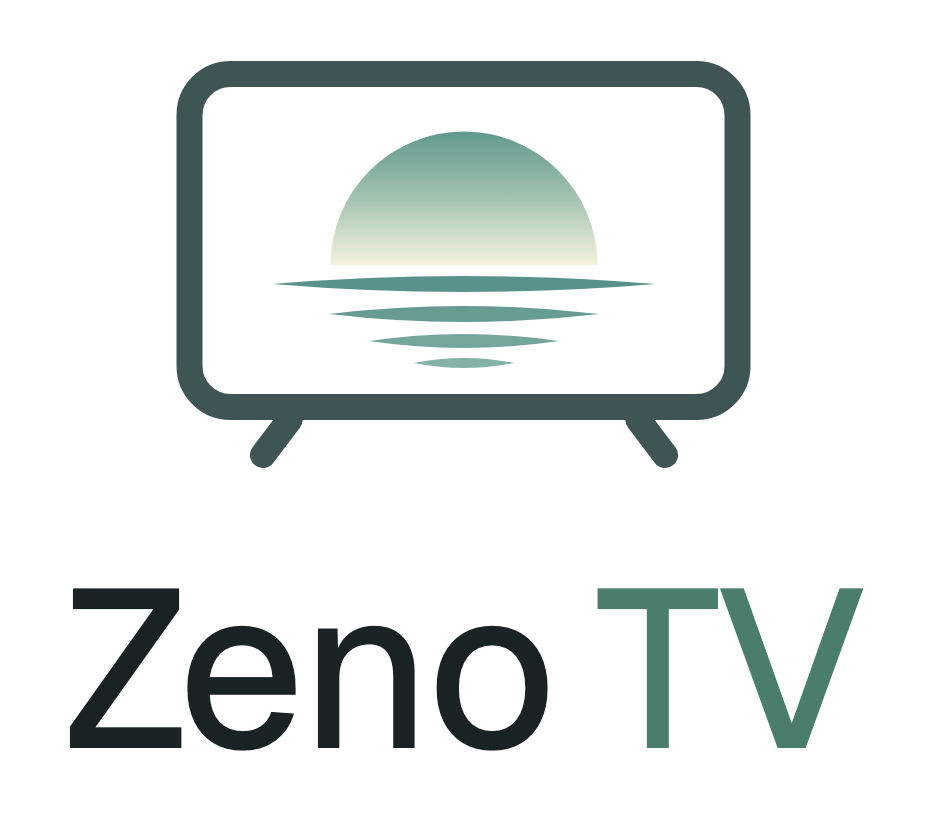
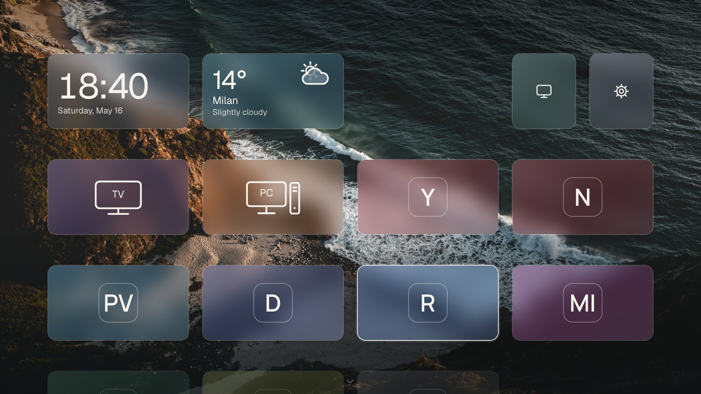
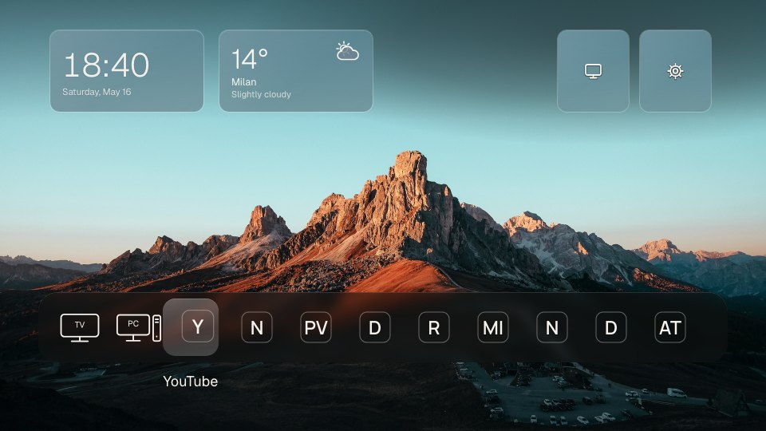
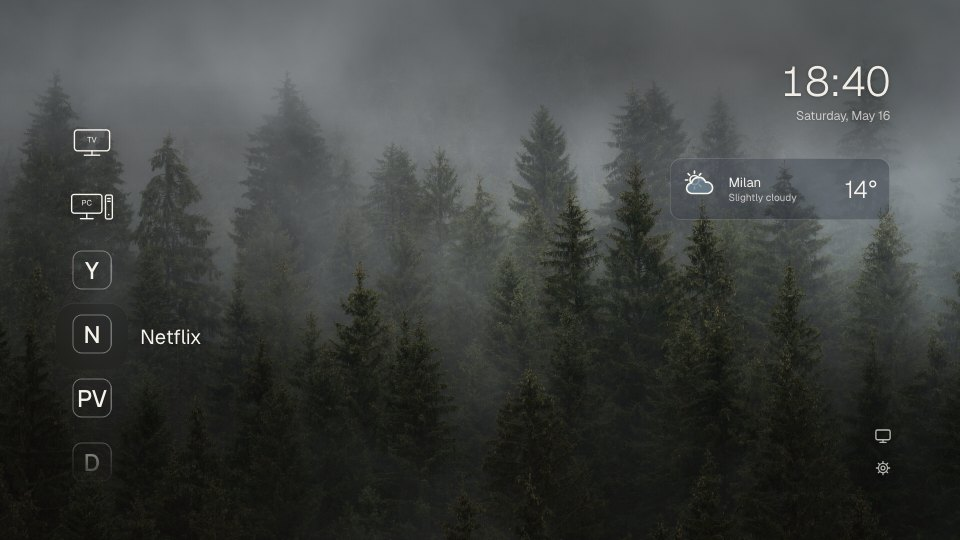
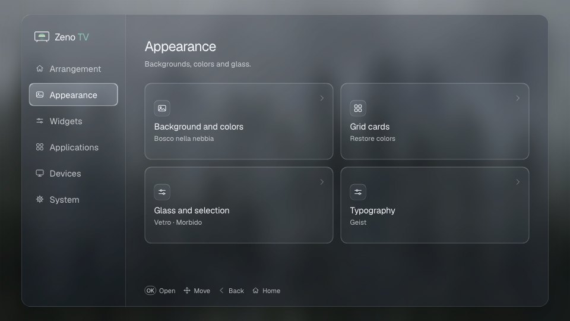

<p align="center">
  <picture>
    <source media="(prefers-color-scheme: dark)" srcset="docs/images/logo-dark.png">
    
  </picture>
</p>

<p align="center">A quiet home screen for Samsung TVs.</p>



## Why I made it

I bought a good TV and every time I turned it on, before I could pick what to watch, it showed me ads. Trailers that start playing on their own, banners for shows I'd never watch, a row of "recommended" things, apps I never installed sitting next to the ones I use every day. The home screen felt like a shop window, not something that belonged to me.

I didn't want a new launcher full of features. I wanted less. The few apps I actually open, a nice photo behind them, the time and the weather. Nothing that moves unless I move it.

So I wrote Zeno. It runs as an app on the TV and you use it as your home screen. Nothing in the system gets changed or removed: if you want the original back, you just open it.

## What it does

- **Shows only your apps.** Zeno lists whatever is installed on the TV, with each app's own name and icon. On the first start it puts them on the Home; then you pick which ones stay and in what order. Everything else waits in an "All apps" page, out of the way.
- **Three layouts.** A grid of cards you can place where you like, a dock along the bottom, or a plain list.
- **Cards that match the apps.** In the coloured card style, each card takes the main colour of its app's icon.
- **A few small widgets.** Clock (with other time zones and a timer that keeps ringing until you press a key), weather, music and your HDMI inputs.
- **Some quiet music.** Six tracks made for Zeno: jazz lounge, piano, ambient, rain, sea waves and brown noise. You can add your own.
- **HDMI devices as tiles.** Give them a name and an icon. It can also wake a PC over the network before switching to its input.
- **Photos as the background.** Fourteen are included. The text and the glass behind the cards adjust their colour to each photo, so they stay readable.
- **Made for the remote.** Arrows, OK and Back are all you need. Hold OK on something to see more options.
- **No account, no ads, no tracking.**
- **30 languages**, right-to-left included.

It's also light. Blur effects are prepared in advance, so the TV only has to show images, not compute them.

<table>
  <tr>
    <td width="33%"></td>
    <td width="33%"></td>
    <td width="33%"></td>
  </tr>
  <tr>
    <td align="center"><sub>Dock</sub></td>
    <td align="center"><sub>List</sub></td>
    <td align="center"><sub>Settings</sub></td>
  </tr>
</table>

## Does it work on my TV?

I made it on a Samsung S90D with Tizen 9, and that's the only TV I've tested it on. Other recent Samsung TVs should work. If you try it on yours, [tell me how it went](https://github.com/dev-matru/zeno-tv/issues/new?template=2-tv-report.yml), even if everything worked.

It doesn't work on LG, Sony, Android TV or other brands. It's a Tizen app.

## Try it on your computer

You'll need Node.js 22 or newer and Python 3.10 or newer.

```sh
git clone <this repository> zeno-tv
cd zeno-tv
npm ci
npm run dev
```

Then open [localhost:4795/home](http://localhost:4795/home/). Use the arrow keys, Enter and Escape as if they were the remote. Everything works in the browser except what needs the TV: the list of installed apps, opening them and switching inputs. In the browser the Home starts with just the TV and PC tiles.

## Install it on the TV

Samsung lets you install your own apps once Developer Mode is on, signed with a free developer certificate. The first time takes about an hour, mostly for the certificates. After that, an update takes a minute.

In short:

1. Install the Samsung TV SDK.
2. Turn on Developer Mode on the TV and enter your computer's IP address.
3. Create your author and distributor certificates with Samsung's Certificate Manager.
4. Give the app your own IDs.
5. Run `npm run package`, then `npm run tv:install` and `npm run tv:launch`.

Every step is explained in [docs/tv-setup.md](docs/tv-setup.md).

## Your own fonts, logos, photos and music

If you have fonts, app logos, photos or music that you can't share publicly, put them in a private folder that Git ignores. They get added only to your build, never to the repository. For music, drop your audio files in `.local/personal/music/` and they show up in the music widget after the built-in tracks. How it works: [docs/development.md](docs/development.md#personal-assets).

## Contributing

Bug reports, TV reports and ideas are welcome: pick a form when you [open an issue](https://github.com/dev-matru/zeno-tv/issues/new/choose). Before a pull request, have a look at [CONTRIBUTING.md](CONTRIBUTING.md).

## Credits

Photos from Unsplash, fonts under the Open Font License, music and sounds made for Zeno. The full list is in [docs/credits.md](docs/credits.md). Zeno TV is released under the [MIT License](LICENSE).
